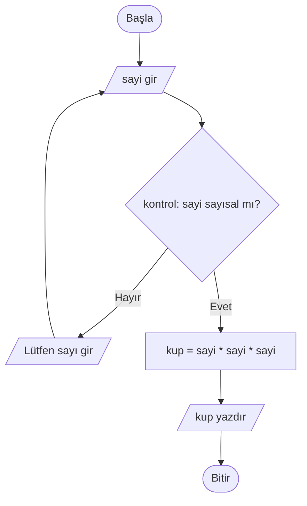
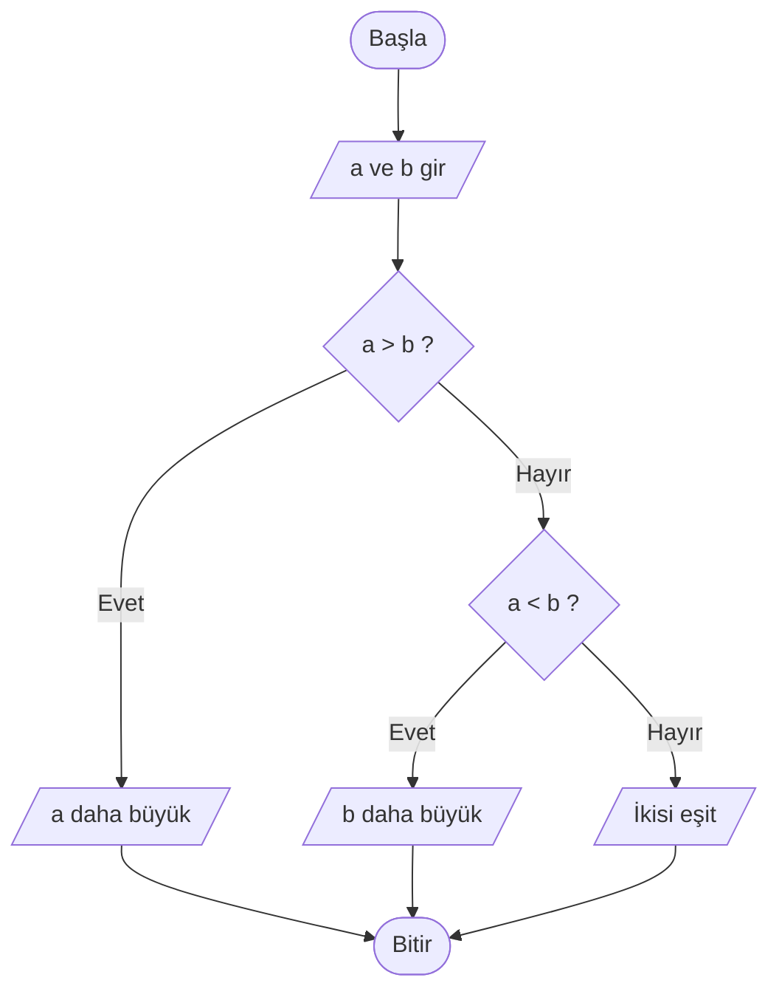

# Bölüm 3 Ödevi — Akış Diyagramları

İki algoritma: (1) girilen sayının küpü, (2) iki sayıdan büyük olanı.

## 1) Girilen sayının küpünü bulan algoritma



**Pseudo kod**
```
BAŞLA
  sayi oku
  kup = sayi * sayi * sayi
  kup yazdır
BİTİR
```

## 2) İki sayıdan büyük olanı bulan algoritma



**Pseudo kod**
```
BAŞLA
  a oku, b oku
  EĞER a > b İSE "a büyük" yaz
  DEĞİLSE EĞER a < b İSE "b büyük" yaz
  DEĞİLSE "eşit" yaz
BİTİR
```

## Basit çalışan örnek

`kup-ve-buyuk.js` dosyasında iki fonksiyon var:

```bash
node bolum3/kup-ve-buyuk.js
```
